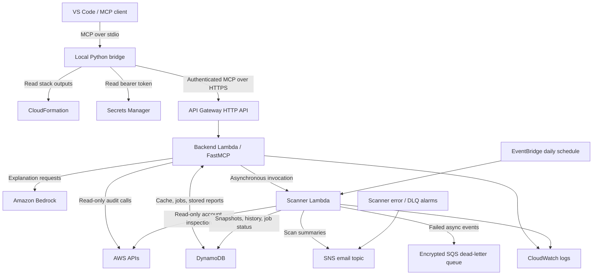

# AWS Assistant

**An AWS-hosted Model Context Protocol (MCP) service for account inspection, security findings, cost visibility, and operational diagnostics.**

AWS Assistant connects an MCP-compatible AI client to read-only AWS inspection tools. It supports individual tool calls and asynchronous account scans, stores reports in DynamoDB, and publishes scan summaries through Amazon SNS. Amazon Bedrock provides service explanations.

The active deployment is the **MCP-only backend**. No EC2 server or React application is required. Dashboard, OAuth, and cross-account modules are retained as supporting/reference code; they are not enabled by the MCP-only deployment.

## Capabilities

- Inspect spending, forecasts, cost anomalies, and Free Tier usage.
- Identify public S3 access, IAM hygiene issues, root-account risks, and exposed administrative ports.
- Find unattached EBS volumes, unused Elastic IPs, and snapshots requiring retention review.
- Read Lambda logs and metrics, running EC2/RDS resources, and active CloudWatch alarms.
- Queue scans across enabled AWS regions and retrieve stored account reports.
- Explain AWS services through the configured Amazon Bedrock model.

Inspection tools do not modify audited resources. Scan requests write assistant job/report records and can publish notifications. Suggestions to remove or reconfigure resources require a separate, deliberate action outside these tools.

## Architecture



### Components and responsibilities

| Component | Responsibility |
|---|---|
| Local bridge | Loads stack outputs and the secret using the local AWS profile, initializes the remote MCP session, and forwards tool discovery and calls over stdio. |
| API Gateway | Hosts the HTTPS `/mcp` endpoint and public `/health` route, with request throttling. |
| Backend Lambda | Registers tool schemas, authenticates bearer tokens, executes individual inspections, serves stored reports, and queues scans. |
| Scanner Lambda | Executes global checks once and regional checks across enabled regions; stores snapshots/history and updates job status. |
| DynamoDB | Stores bounded caches, scan leases, job status, the latest report, and historical summaries. |
| Secrets Manager | Generates and stores the MCP operator token. |
| Bedrock | Produces AWS service explanations through the Converse API. |
| SNS / CloudWatch / SQS | Publish notifications, retain logs, raise operational alarms, and capture failed asynchronous events. |
| IAM | Grants inspection access plus narrowly scoped writes to assistant-owned storage and supporting services. |

### Individual tool request

1. The AI client launches the local bridge and requests the tool catalog.
2. The bridge discovers the stack endpoint and retrieves the token without printing it.
3. The backend authenticates the request and validates the tool inputs.
4. Eligible calls use cached data or inspect AWS through the backend execution role.
5. A structured response returns findings, errors, timestamps, and truncation information to the client.

### Account scan

1. `request_account_scan` reserves a scan job in DynamoDB. Repeated requests return the active job rather than queueing duplicates.
2. The backend asynchronously invokes the scanner and returns a `job_id`.
3. The scanner runs global checks once and processes up to three regions concurrently. Regional SDK clients are closed after use to bound memory consumption.
4. The scanner publishes the latest snapshot, invalidates earlier cache generations, records historical summary data, and marks the job complete.
5. SNS receives a scan summary. Clients poll `get_scan_status` and then retrieve the stored report.

The default daily schedule is **20:00 UTC**, equivalent to **01:30 IST the following day**. Prefer asynchronous scans for full account reports; `live=true` can exceed the HTTP API request deadline.

## Project structure

```text
Aws-Assistant/
├── README.md
├── LICENSE
├── .gitignore
├── .vscode/
│   └── mcp.json                  # VS Code workspace configuration
├── mcp.json                     # Client-specific stdio configuration
└── backend/
    ├── src/
    │   ├── app.py               # FastMCP, authentication, HTTP/Lambda adapter
    │   ├── vscode_bridge.py     # Local stdio-to-HTTPS MCP bridge
    │   ├── tools.py             # Tool catalog, validation, AWS inspections
    │   ├── models.py            # Response contracts, scoring, output bounds
    │   ├── storage.py           # Cache, scan jobs, snapshots, history
    │   ├── connections.py       # Optional registered cross-account roles
    │   ├── oauth.py             # Retained OAuth support; inactive in MCP-only mode
    │   ├── worker.py            # Retained dashboard worker
    │   └── demo.py              # Local demonstration data
    ├── tests/                   # Regression tests and mocked AWS checks
    ├── requirements.txt
    ├── requirements-dev.txt
    ├── pyproject.toml
    ├── mcp-template.yaml        # Active MCP-only infrastructure
    ├── mcp-fixtures.yaml        # Optional test resources; may incur charges
    ├── template.yaml            # Full-stack reference infrastructure
    ├── connected-account.yaml  # Optional cross-account reference
    ├── MCP-SETUP.md              # Detailed deployment guide
    ├── VSCODE-SETUP.md           # Client connection guide
    └── VS-CODE-CONFIG.json       # Reference user configuration
```

## Tool catalog

The MCP-only deployment exposes **20 tools** when scan tools are enabled.

| Area | Tools |
|---|---|
| Cost and usage | `get_cost_breakdown`, `get_cost_forecast`, `find_cost_anomalies`, `get_free_tier_usage` |
| Security | `find_public_buckets`, `audit_iam_users`, `check_open_security_groups`, `get_root_account_status` |
| Resources and waste | `list_running_resources`, `find_unused_ebs_volumes`, `find_unused_elastic_ips`, `find_old_snapshots` |
| Operations | `get_lambda_logs`, `get_lambda_metrics`, `list_active_alarms` |
| Reports and scans | `generate_account_health_report`, `request_account_scan`, `get_scan_status` |
| Advice and diagnostics | `explain_aws_service`, `echo` |

Most inspection tools accept `limit`, `refresh`, and `region`. Time-related parameters vary: `days`, `older_than_days`, `minutes_back`, or `hours_back`. Lambda log/metric tools require `function_name`. Use the MCP tool schema as the authoritative input contract.

The report uses the stored snapshot by default. `refresh=true` bypasses eligible tool caches. Cached cost checks expire after one hour; other cached checks expire after 15 minutes. Historical summaries and individual scan records use a 90-day TTL; the latest snapshot is retained until replaced.

## Local setup

### Prerequisites

- Python 3.12 is recommended for development and matches the deployed Lambda runtime.
- AWS CLI with a valid profile, including an existing SSO profile if applicable.
- VS Code with an MCP-capable client, or another compatible MCP client.
- For deployment: AWS SAM CLI and Docker with Linux containers.

The ZIP excludes `.venv`, dependencies, credentials, and build artifacts. Create a fresh environment after extraction. Run the following commands from the **extracted project root**:

```powershell
py -3.12 -m venv backend/.venv
& ./backend/.venv/Scripts/python.exe -m pip install -r backend/requirements-dev.txt
aws sts get-caller-identity
```

To use a named profile in the terminal:

```powershell
$env:AWS_PROFILE = 'your-profile'
aws sts get-caller-identity
```

For VS Code, pass `--profile` and the profile name in the server's `args` when VS Code does not inherit the terminal environment. SSO credentials require an active login for that profile.

The local bridge requires `cloudformation:DescribeStacks` on the selected stack and `secretsmanager:GetSecretValue` on its token secret. AWS inspection permissions belong to the Lambda execution roles; local administrator access is unnecessary for normal bridge operation.

### Connect VS Code

1. Open the extracted **Aws-Assistant folder**, not only its `backend` subfolder.
2. Create the virtual environment and install dependencies as above.
3. Review `.vscode/mcp.json`. It uses workspace-relative paths and defaults to stack `aws-assistant-mcp` in `us-east-1`.
4. Run **Developer: Reload Window** from the Command Palette.
5. Run **MCP: List Servers**, select `aws_assistant`, and start it.
6. Open Copilot Chat in Agent mode and enable the server's tools.

VS Code configuration uses the top-level **`servers`** key. The root `mcp.json` uses **`mcpServers`** for other clients and retains the original machine's absolute paths; update those paths if using that file after extraction. `VS-CODE-CONFIG.json` is a reference user configuration, not an automatically loaded project configuration. Avoid starting duplicate user and workspace instances.

### Verify the connection

Send these prompts one at a time:

| Prompt | Expected result |
|---|---|
| “Call aws_assistant echo.” | `AWS Assistant ready` |
| “Call find_unused_ebs_volumes with region us-east-1 and refresh true.” | A tool result; empty findings can be valid. Inspect `errors`. |
| “Call request_account_scan.” | A job ID and queued/running status. |
| “Call get_scan_status with that job ID.” | Poll until `COMPLETED` or `FAILED`. |
| “Call generate_account_health_report with live false.” | The stored account report. |
| “Explain S3 public access risks using explain_aws_service.” | A Bedrock-generated explanation when the model is available. |

Confirm the SNS subscription email before expecting email notifications. Confirmation enables future deliveries; earlier messages are not automatically replayed.

## Deploy to AWS

Use **`backend/mcp-template.yaml`** for the active deployment. The full-stack `template.yaml` is a reference and creates a different set of services.

Run each command separately from `backend` and stop if it fails:

```powershell
sam validate --lint --template-file mcp-template.yaml
sam build --use-container --template-file mcp-template.yaml --build-dir .aws-sam/mcp-build
sam deploy --guided --template-file .aws-sam/mcp-build/template.yaml --config-file samconfig-mcp.toml --stack-name aws-assistant-mcp --region us-east-1 --capabilities CAPABILITY_IAM
```

Configure `NotificationEmail`, `MonthlyBudget`, `BedrockModelId`, and `EnableAnomalyMonitor` during deployment. Budget alerts do not enforce a spending limit. An existing account anomaly monitor can require disabling the optional monitor in this stack.

The stack outputs include `MCPUrl`, `ApiUrl`, `TokenSecretArn`, function names, and execution-role ARNs. The local bridge reads the endpoint and secret automatically. A new machine still requires access to the deployed stack; extracting the ZIP does not create AWS resources.

See [the detailed deployment guide](backend/MCP-SETUP.md) for parameters, optional fixtures, manual HTTP checks, and account prerequisites. If that guide shows the original Windows project path, replace it with your extraction path.

## Security and response behavior

- The MCP-only deployment uses a Secrets Manager bearer token. OAuth is disabled in this mode.
- Token holders can read account audit data and queue scans. Keep the token out of source, client transcripts, and logs.
- The backend caches the token for 60 seconds. The bridge loads it at startup; restart the bridge after rotation.
- Lambda uses temporary execution-role credentials. No local AWS keys are embedded in deployed code.
- Input values are bounded with Pydantic. HTTP request bodies are limited to 64 KiB, and tool responses are bounded to approximately 500 KB.
- DynamoDB snapshots/cache items use a conservative 300 KB limit. Oversized responses retain truncation and coverage information.
- AWS SDK connections/read operations use 2/5-second timeouts and one total attempt. These limits bound individual requests; they do not guarantee a whole audit finishes within the HTTP deadline.
- The bridge limits remote MCP response waits to 45 seconds. S3 inspection uses eight concurrent workers; all-region scanning uses three regional workers.
- Resource names, logs, and other returned AWS data are untrusted content, not instructions for an AI client.

Results contain `summary`, `findings`, `data`, `errors`, `observed_at`, and `truncated`. Account reports also contain `score` and `coverage`. A successful transport response can still contain inspection errors. Missing evidence or truncation produces partial coverage and a null health score rather than a misleading clean report.

Health scores subtract severity weights from 100: Critical 20, High 8, Medium 2, and Low 1 per finding, with a floor of zero. The score is a prioritization aid, not a compliance certification. Savings estimates are approximate.

## Testing and verified release

From the project root:

```powershell
Push-Location backend
& ./.venv/Scripts/python.exe -m pytest -q
Pop-Location
```

Verification on **14 October 2026**:

| Check | Result |
|---|---|
| Regression suite | 66 tests passed on the existing Python 3.11 development environment. |
| Deployment templates | MCP deployment and fixture templates passed SAM lint. |
| Deployed runtime | Python 3.12. |
| MCP transport | Initialization and discovery of 20 tools passed through the stdio bridge and deployed endpoint. |
| Individual tools | Audit, diagnostic, Lambda log/metric, and Bedrock calls exercised live; forecast returned an explicit AWS data limitation. |
| Full scan | Completed successfully; stored all-region report retrieved through MCP. |
| Scanner resources | 41.1-second execution; 437 MB peak memory within the unchanged 512 MB allocation. |
| Notifications | SNS publication verified; email delivery requires a confirmed subscription. |

This release repairs the VS Code configuration schema, indefinitely waiting bridge calls, sequential S3 inspection latency, and scanner memory exhaustion. Both Lambda functions received the fixes. The account's unavailable Cost Explorer forecast correctly remains a report coverage gap.

Finite tests do not establish that every feature is error-free. The VS Code UI itself and inbox delivery were not automated acceptance checks. Optional fixtures, cross-account setup, and the retained full-stack path require their own validation.

## Troubleshooting

| Symptom | Checks and next action |
|---|---|
| Server missing in VS Code | Open the project root; inspect `.vscode/mcp.json`; use `servers`, not `mcpServers`; reload the window. |
| Python executable missing | Recreate `backend/.venv` after extracting the ZIP and install the requirements. |
| AWS credential/profile error | Run `aws sts get-caller-identity` for the same profile; refresh SSO login if necessary. |
| Stack or secret access denied | Check `--region`, `--stack`, `--profile`, and the bridge identity's stack/secret permissions. |
| HTTP 401 | Check token access/rotation and restart the bridge. |
| Browser GET `/mcp` returns 405 | Expected: the endpoint uses stateless JSON Streamable HTTP. Use an MCP client or authenticated POST. |
| Tool times out | Inspect Backend Lambda logs; use asynchronous scans for account-wide work. |
| Scan fails | Inspect Scanner Lambda logs, job status, and the dead-letter queue. |
| `DataUnavailableException` from forecast | AWS has no usable forecast data for the requested period. Inspect billing history/Cost Explorer availability. |
| Report is pending | Queue a scan, wait for completion, then read the stored report. |
| No notification email | Check SNS subscription confirmation and the email spam folder; verify a new scan publishes after confirmation. |

Use **MCP: List Servers → aws_assistant → Show Output** for client-side diagnostics. See the deployed functions' CloudWatch logs for backend errors. Never paste bearer tokens or AWS secrets into issue reports.

## Extending the project

Add the catalog entry and input validation in `tools.py`, implement the inspection, register its MCP signature in `app.py`, and grant only the required read actions in `mcp-template.yaml`. Add it to `AUDITS` only if it belongs in account-wide scans. Add regression coverage, then rebuild and deploy through SAM. Do not grant destructive permissions merely to suggest remediation.

## License

MIT. See [LICENSE](LICENSE).
